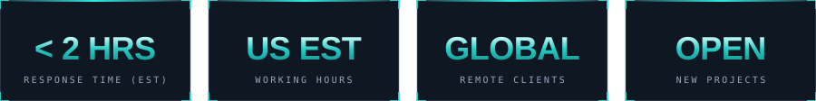
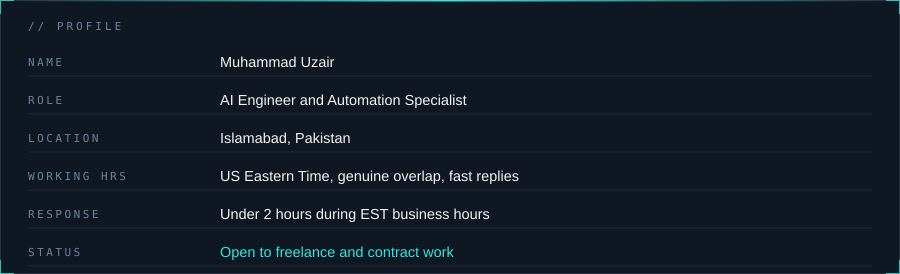
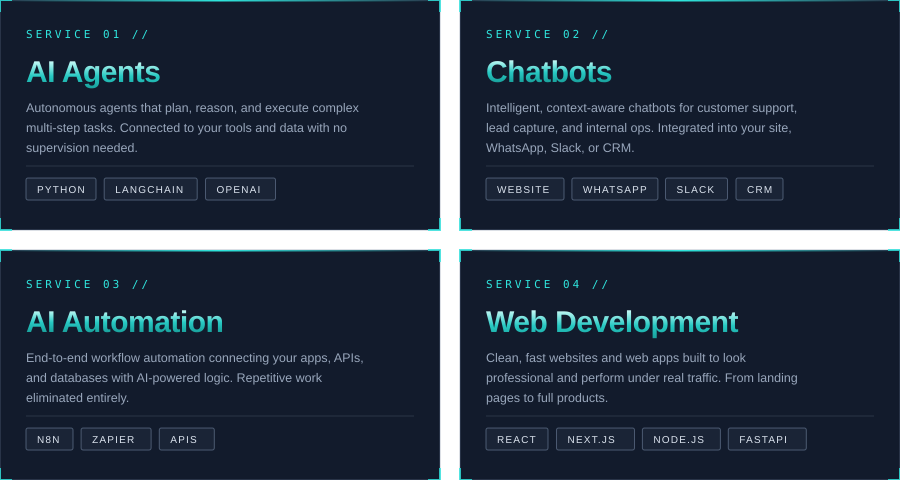
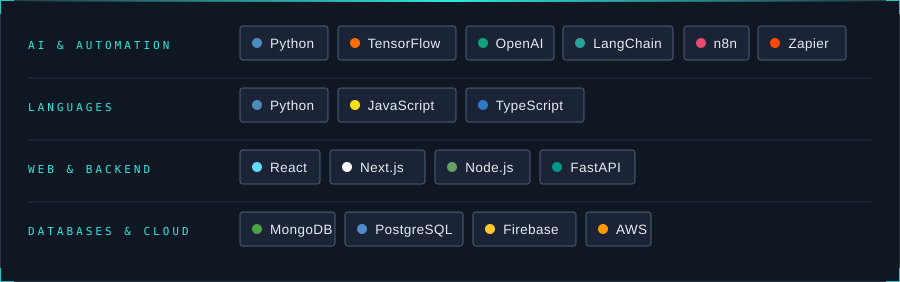
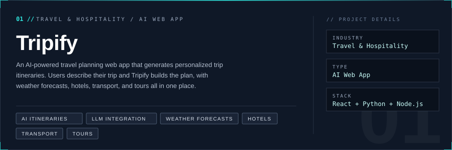
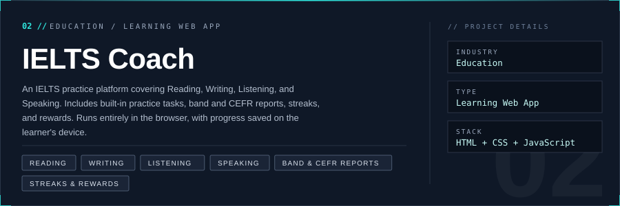

&nbsp;

&nbsp;

 

<h2 align="center">About Me</h2>

I build AI systems that do real work for businesses. Not prototypes, not demos. Production-ready chatbots, AI agents, and automation pipelines that handle real traffic and real edge cases.

If your team is spending hours on something a well-built AI system could handle, that is exactly what I fix. I have worked with clients across travel, hospitality, and operations, delivering systems that run cleanly in production and are handed off with full documentation.

<h2 align="center">What I Build</h2>

Tailored AI solutions that solve real business problems. Built to ship, not to demo.

<h2 align="center">Tech Stack</h2>

<h2 align="center">Featured Projects</h2>

Real solutions. Real impact.

&nbsp;

 

&nbsp;

 

<h2 align="center">GitHub Stats</h2>

&nbsp;

 

<h2 align="center">Contact</h2>

I am open to freelance and contract projects with US clients. First call is free with no obligation.

 

