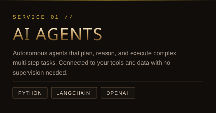
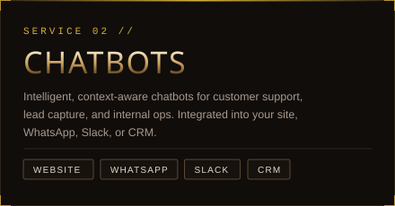
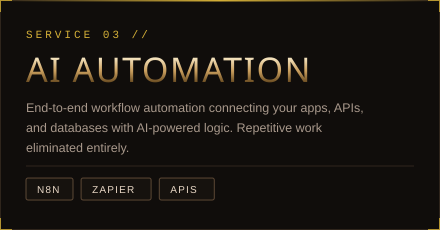
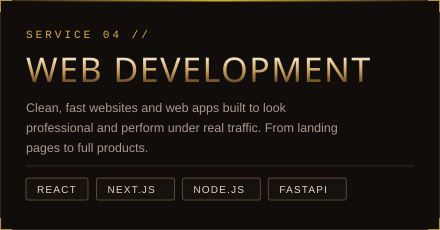

&nbsp;

&nbsp;

 

 

I build AI systems that do real work for businesses. Not prototypes, not demos. Production-ready chatbots, AI agents, and automation pipelines that handle real traffic and real edge cases.

If your team is spending hours on something a well-built AI system could handle, that is exactly what I fix. I have worked with clients across travel, hospitality, and operations, delivering systems that run cleanly in production and are handed off with full documentation.

 

<table>
<tr>
<td></td>
<td></td>
</tr>
<tr>
<td></td>
<td></td>
</tr>
</table>

 

&nbsp;&nbsp;

&nbsp;

&nbsp;

&nbsp;

  

&nbsp;

  

&nbsp;

  

&nbsp;

  

I am open to freelance and contract projects with US clients. First call is free with no obligation.

 

&nbsp;

&nbsp;

 

